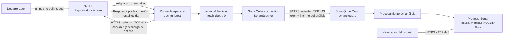

# Arquitectura del escaneo con SonarQube Cloud

Este diagrama representa el workflow `.github/workflows/curso_gha-sonar.yml`.
El job obtiene el repositorio en un runner hospedado por GitHub, analiza los
archivos incluidos en `sonar.sources` y envía el informe a SonarQube Cloud.
Este workflow no compila ni ejecuta pruebas.

## Límites y tráfico de red

- El runner inicia las conexiones; no se requiere abrir puertos entrantes en
  el equipo del desarrollador.
- El checkout y la descarga de acciones requieren acceso HTTPS a GitHub. La
  acción también puede descargar el scanner o sus componentes desde los
  servicios de distribución de SonarSource.
- El análisis se comunica con `sonarcloud.io` por HTTPS (TCP 443). La respuesta
  vuelve por la conexión ya establecida; no se necesita una regla de entrada
  hacia el runner.
- El informe enviado a SonarQube Cloud puede incluir el contenido de los
  archivos fuente analizados para contextualizar los hallazgos. No se envía el
  repositorio como un `git push`, ni se envía la aplicación para ejecutarla.
- `SONAR_TOKEN` autentica el análisis. Debe mantenerse como secreto de GitHub,
  nunca como texto en el workflow.
- El paso de análisis se omite en pull requests procedentes de forks, porque
  GitHub no proporciona secretos del repositorio a esos workflows.

Las reglas de firewall/proxy de una organización deben permitir el tráfico
HTTPS saliente requerido por GitHub Actions y SonarQube Cloud. Los dominios
exactos adicionales pueden depender de la versión de las acciones y del
scanner.
