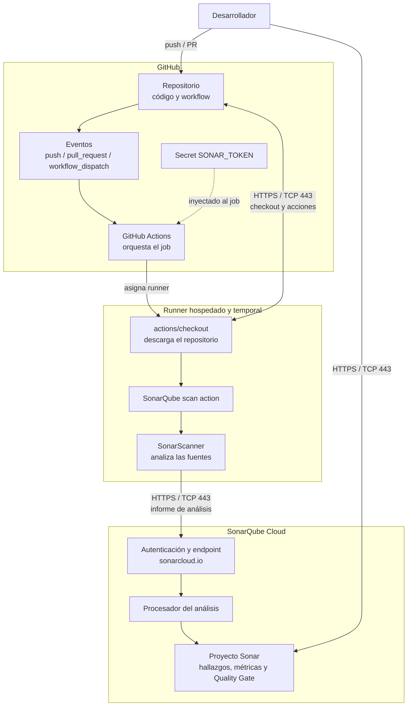

# Componentes del escaneo con SonarQube Cloud

## Responsabilidad de cada componente

| Componente | Función |
|---|---|
| GitHub Repository | Guarda el código y `.github/workflows/curso_gha-sonar.yml`. |
| GitHub Actions | Inicia el job según el evento y asigna el runner. |
| `SONAR_TOKEN` | Permite autenticar el análisis; se configura como secreto del repositorio. |
| Runner | Descarga el checkout y las acciones; es efímero y hospedado por GitHub. |
| SonarQube scan action / SonarScanner | Analiza los archivos y publica el informe. No ejecuta el build ni las pruebas en la configuración actual. |
| SonarQube Cloud | Procesa el informe y presenta los hallazgos, métricas y Quality Gate. |

El análisis se asocia a la organización y al Project Key configurados como
argumentos del scanner en el workflow. Esos identificadores deben coincidir
exactamente con los del proyecto creado en SonarQube Cloud.
