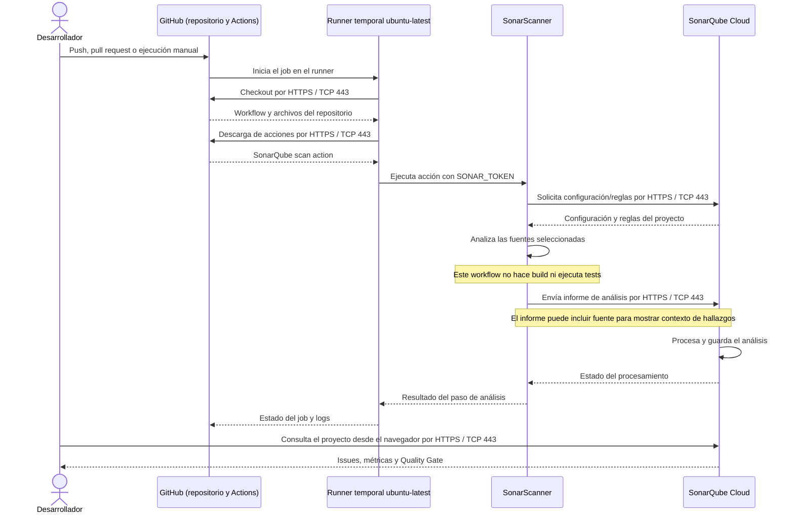

# Secuencia del escaneo con SonarQube Cloud

## Conexiones

El tráfico indicado es iniciado por el runner o por el navegador del usuario.
Las respuestas regresan por las conexiones HTTPS existentes, por lo que este
flujo no requiere publicar el runner en Internet ni abrir un puerto entrante.
